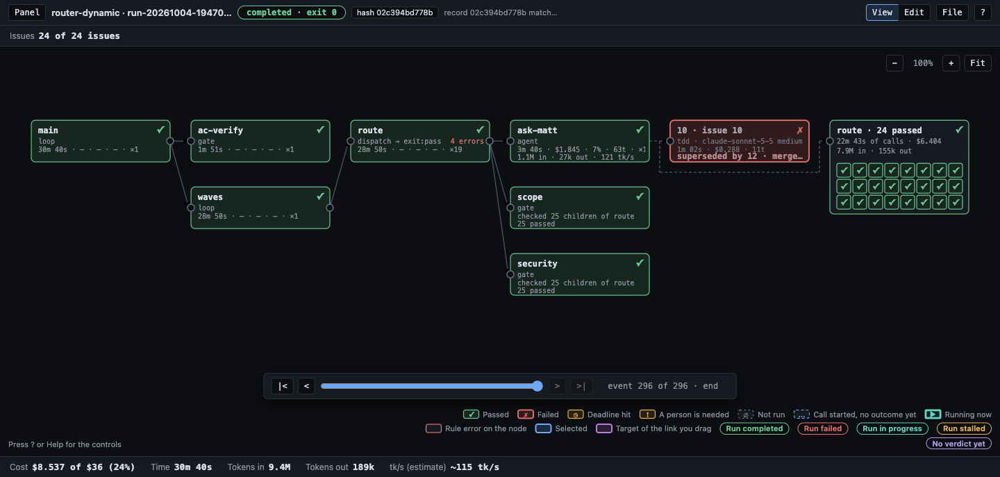
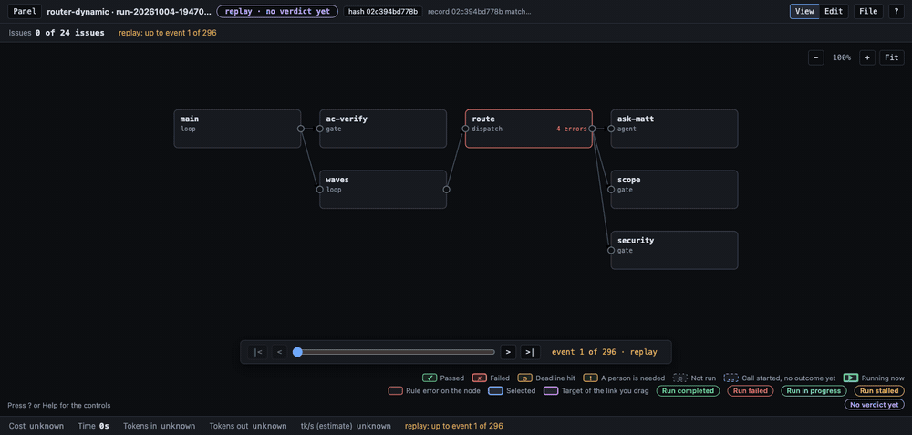
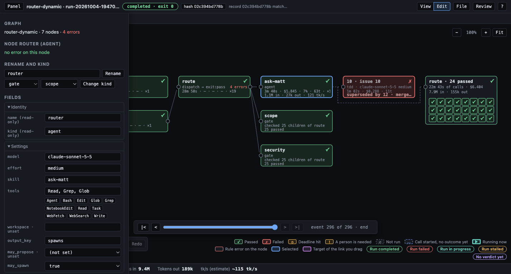

<div align="center">

# agent-squad

**Give a coding agent a request. Get back a reviewed, tested change, with a record of every step.**

A self-adapting orchestration graph on the [Claude Agent SDK](https://docs.claude.com/en/docs/claude-code/sdk).
The workflow is data you can read, edit, and review. Code enforces every limit.

[](https://github.com/mmctech-ai/agent-squad/actions/workflows/ci.yml)


[](LICENSE)

[Quick start](#quick-start) · [How it works](#how-it-works) · [Commands](#commands) · [The dashboard](#the-dashboard) · [Docs](#docs)



<sub>A real run on the subject project, a Python billing engine with 24 issues. 24 passed, 25 children landed, $8.54 spent.</sub>

</div>

---

## Why agent-squad

One long agent session drifts. It forgets the plan, skips the tests, and tells you it is done. You cannot review what you cannot see.

agent-squad splits the work across short, focused sessions and puts a graph around them.

- **The workflow is a file.** A graph document lists the nodes and the order. You open it in an editor, change it, and commit it.
- **A model asks, code decides.** A router agent requests child agents. Code checks each request against limits the author fixed. A request over any limit is rejected whole.
- **A model never merges.** A child that passes its checks lands in your repo in request order. A conflict fails that child and nothing else.
- **Gates are deterministic.** A gate runs code, not a model. It stops the run or repeats a loop. Nothing tunes a gate to make it pass.
- **Every run leaves a record.** One append-only file holds every event. You replay a run, resume it after a crash, or hand it to someone else.
- **A run has caps.** Spend, turns, and wall-clock time are limited per node and per run. Reaching a deadline is its own outcome, not a failure.

## Quick start

You need [Claude Code](https://claude.com/claude-code), [`uv`](https://docs.astral.sh/uv/) and `git`. Nothing else: the first `/agent-squad:work` or `/agent-squad:task` lets `uv` fetch Python 3.11 or later and the `claude-agent-sdk` (the `sdk` extra), which carries its own Claude Code binary. Node is not required.

Install the plugin once:

```bash
claude plugin marketplace add mmctech-ai/agent-squad
claude plugin install agent-squad@agent-squad --scope user
```

Then, inside any project in Claude Code:

```text
/agent-squad:work add a retry with backoff to the uploader
```

A router agent reads the request and your `CLAUDE.md`. It asks for children. Code runs them, checks them, and lands the ones that pass. The command prints the run folder and the verdict.

Open the workflow editor:

```text
/agent-squad:editor
```

Run one narrow task instead of a request:

```text
/agent-squad:task fix the failing date parser test
```

> Requires Python 3.11 or later, [`uv`](https://docs.astral.sh/uv/), and a logged-in Claude Code.

## Commands

| Command | What it does |
| --- | --- |
| `/agent-squad:work <request>` | Starts a run from a request. The router decides what children it needs. |
| `/agent-squad:task <task>` | Starts a run for one task. The router asks for the fewest children that finish it. |
| `/agent-squad:dashboard [run]` | Opens the dashboard page for one run; the latest when empty. It never starts a run. |
| `/agent-squad:skill-update` | After a skill update, checks that every borrowed skill still resolves. It never edits `~`. |
| `/agent-squad:editor [id]` | Opens the workflow editor on a workflow. No id opens the dynamic workflow. |

Every start command takes `--workflow <id>`. Without it, the run uses the **dynamic workflow**. With it, the run uses `docs/squad/workflows/<id>.graph.json`. The editor saves to the same folder.

The same commands exist as a CLI:

```bash
squad start "add a retry with backoff to the uploader"
squad start --task "fix the failing date parser test" --workflow five-phases
squad editor
squad dashboard            # latest run
squad resume <run-id>      # continue after a crash or a wait
```

## How it works

```text
request ──► router agent ──► spawn requests ──► envelope check ──► child agents
                                                     │                  │
                                              rejected whole       worktree each
                                                                        │
              verdict ◄── final gate ◄── landing (code merges) ◄── scope + security gates
```

The graph has seven kinds of node:

| Node | Role |
| --- | --- |
| **agent** | One model session with a declared model, tools, and budget. |
| **gate** | A deterministic check. No model call. |
| **loop** | Repeats its children up to a maximum. The maximum only shrinks at run time. |
| **each** | Runs its children once per item, in parallel or in sequence. |
| **action** | Deterministic code with a declared side effect, such as a commit or a merge. |
| **wait** | Holds the run until a person acts. The process exits with code 10 and resumes later. |
| **dispatch** | Lets an agent request children at run time, inside an **envelope** the author fixes. |

An **authored flow** has no dispatch node, and you wire every step. A **dynamic flow** has one, and a router agent chooses the children. Both ship in this repo:

- [`docs/design/five-phases.graph.json`](docs/design/five-phases.graph.json): scout, spec, decompose, execute, verify, with actor-critic loops and gates.
- [`docs/design/router.graph.json`](docs/design/router.graph.json): the dynamic workflow, and the default.

A run ends with one verdict. The exit code follows from it.

| Verdict | Exit code |
| --- | --- |
| completed | 0 |
| failed | 1 |
| needs-human | 10 |
| conflict | 20 |
| stopped | 30 |

## The dashboard

One page per run. It loads the graph, follows the record live, and lets you replay any run event by event.

```bash
squad dashboard
```

<p align="center"></p>

The replay above scrubs the same run from event 1 to event 296.

- Drag, zoom, and edit nodes. Validation errors show on the node, and a save is never blocked.
- Replay a run with a cursor. A live run stays pinned to the last event.
- Pause or resume a launched run. This is the page's only write.
- See which skills a run could load, by hash.

<p align="center"></p>

The page is one HTML file with no build step. A loopback server feeds it, and the server exits when idle.

## Principles

- **A failing gate is a defect.** You investigate it. You never retune the threshold to pass.
- **The record is the truth.** A transcript is not run truth. The verdict comes from the record.
- **Skills are pinned.** A run records the hash of every skill it can load. A resume refuses when one differs.
- **Decisions are written down.** [49 ADRs](docs/adr/README.md) say why the code looks the way it does. An ADR is a guide, not a lock.

## Develop

```bash
git clone https://github.com/mmctech-ai/agent-squad
cd agent-squad
uv sync --extra dev --extra sdk
python3 -m pytest -n auto       # parallel
python3 -m pytest -p no:xdist   # serial: both modes must pass
ruff check squad tests && mypy squad
```

CI runs ruff, mypy, and the suite on Python 3.11 and 3.13 for every push to `main` and every pull request.

## Docs

| Read | For |
| --- | --- |
| [`GLOSSARY.md`](GLOSSARY.md) | The words this project uses, and the words it avoids. |
| [`docs/adr/`](docs/adr/README.md) | Every durable decision, with its guard. |
| [`docs/design/`](docs/design/README.md) | The graph schema, the fixtures, and the checkers. |
| [`docs/skill-workflow-map.md`](docs/skill-workflow-map.md) | The skill flow from request to ship. |
| [`CLAUDE.md`](CLAUDE.md) | The rules for agents that work in this repo. |

## License

[MIT](LICENSE). Copyright (c) 2026 Rafael Aguilher da Costa.

## Status

agent-squad is the next version of `dev_squad`, rebuilt on the Claude Agent SDK. It is at version 0.1.3 and changes fast.
