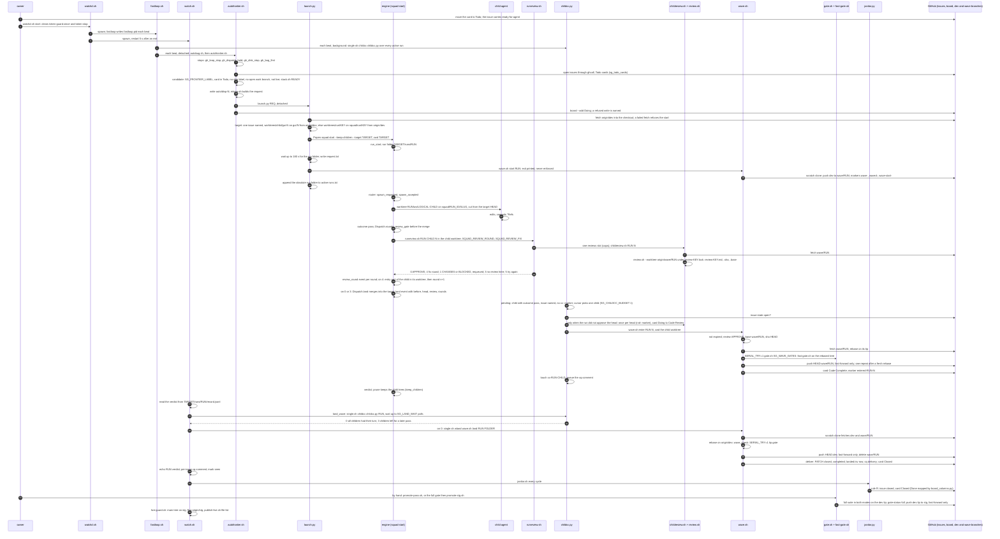
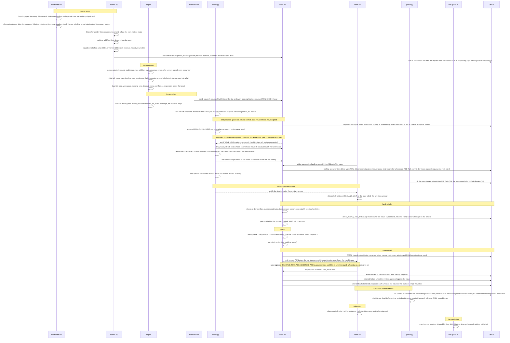

# One issue through the autonomous loop

The trip of one issue from a Todo card to Closed in `dev`: every actor, what each reads and writes, and the failure paths. The doc describes what the code does, defects included, in neutral words. A defect is tracked as an issue, never here. References name a file and a function or step; the code is the source of truth.

Source: `contrib/squad-goal/scripts/*` (live copy `~/.claude/skills/squad-goal/scripts`) and the engine `squad/`. State: `$SG_STATE` (`~/.cache/squad-goal/agent-squad`).
Profile for this repository: `SG_BASE=dev`, `SG_FORK_DIR=$SG_CHECKOUT`, `SG_FORK_BRANCH=gui/%n`, `SG_PROMOTE_PROOF=local`, `SG_BOARD_VOCAB=shipped`.
Shipped columns (`board-definition.json`): Backlog, Todo, Doing, Code Review, Code Complete, Pushing, Testing, Closed, Abandoned. Blocked is no column: it is the `frozen:owner` label over the column the work reached (`board_columns.py`).

`watchd.sh` supervises two lanes:

- **Fast lane** (`fastloop.sh`, every `SG_FAST_INTERVAL` s, 120 by default). Each beat: start one `childcc.py` pass in the background under the `single.sh childcc` lock, unless the pass this lane started still lives; then start `autobug.sh` and, after it ends, `autofrontier.sh`, detached. A new Todo card in the hub's board cache ends the wait early. A lane whose supervisor died exits.
- **Slow lane** (`watch.sh`, about 90 s a cycle). Order: token guard; verdicts and wave landings; stall watchdog; `reconcile.py` (every eighth cycle, detached); `branchland.sh`, `branchreviewpass.sh`, `branchfixpass.sh` (detached, each under its own lock, skipped when `SG_LAND_PAUSED` is set); `childcc.py`, `autobug.sh`, `autofrontier.sh` only when the fast lane is down; `autohunt.sh`; `heartbeat.sh`; `wtclean.sh` (every third cycle); `janitor.sh`; `live-guard.sh`; `vendor-guard.sh`.

Each dispatch pass first runs the stops in `ghcall.sh`, in order. Each stop prints one line, writes it to cycle.log, and the pass dispatches nothing:

- `gh_loop_stop`: an open issue carries `loop-bug` (ADR-0146). `childcc.py` stops on the same label (`loop_defect`).
- `gh_dispatch_hold`: the count in `childcc-waiting` is over `SG_DISPATCH_MAX_WAITING` (unset: no hold; a count over 30 min old: no hold).
- `gh_disk_stop`: the volume of `$SG_STATE` or `$TMPDIR` has less than `SG_MIN_FREE_GB` GiB free (20 by default).
- `gh_bug_first` (`autofrontier.sh` only): `bugs-waiting`, which `autobug.sh` writes, is over 0 and under 30 min old.

No cycle step promotes `dev` to `stg`. The owner starts each promotion (ADR-0145 rule 3).

An arrow to `GitHub` is a fetch, a push or an API call. A review, a rebase, a gate and a scratch clone run on the local machine.

## 1. Happy path

## 2. Step table

The column is the one the writer asks for. A board write that the API refuses leaves the card where it was: the wave entry drops the refusal; the frontier, autobug and the wave landing name it.

| step | actor | reads | writes | column asked |
|---|---|---|---|---|
| 1 | owner | - | card to Todo; `watchd.sh start` (watchd.pid, watch.log) | Todo |
| 2 | fastloop.sh | `SG_FAST_INTERVAL` (`env.sh`); its own childcc pid; Todo cards in the board cache | fastloop.pid every beat; one background childcc pass; autobug then autofrontier, detached | - |
| 3 | autofrontier.sh | the four stops (`ghcall.sh`); open issues (ghcall, one aggregate read); Todo cards; labels: needs `SG_FRONTIER_LABEL`, skips the bug label and `SG_FRONTIER_SKIP_LABELS` (spec, needs-owner, needs-ratification, needs-info, frozen:owner, frozen:dependency, wontfix); disp-/bug- markers; live issues in active runs (`startability.sh`); remote work branches; `stack.sh`; caps, envelope and `fundroom.py` | auto/disp-N; req/NAME.body; mkreq.sh request; cq comment; card Doing | Doing |
| 3b | autobug.sh | the same, over bug issues (go label and Todo card too), with no `gh_bug_first` stop | auto/bug-N; bugs-waiting (startable bugs left with no run); card Doing, and the bug board when `SG_BUG_PROJECT` is set | Doing |
| 4 | launch.py | `origin/$SG_BASE`, fetched now (`_landing_base`); the request's issues (`_issue_named`) | target: the issue worktree `worktrees/child/gui-N` when the request names one issue (`_issue_worktree`; a reused tree is reset to the base, extra commits kept on `refs/squad/leftover/*`, a dirty tree falls back), else its own `worktrees/run/KEY` on `squad/run/KEY` (`_run_worktree`); the engine process with `--keep-children`; `TARGET/runs/RUN/request.txt`, `launch.log`; one active-runs.txt line, absolute | Doing |
| 5 | wave.sh start | origin/dev, origin/wave/RUN (scratch clone) | remote wave/RUN; auto/wave-RUN, waved-RUN, wave-start-RUN | Doing |
| 6 | engine router | request text | record: spawn_requested, spawn_accepted | Doing |
| 7 | child agent | its worktree `RUN/ws/LOGICAL-CHILD`, cut from the target HEAD (`Children.worktree`) | commits "Refs #N" on `squad/RUN_ID/SLUG`; no push | Doing |
| 7b | engine Dispatch.rounds, runreview.sh | the dispatch node's `review` gate (`review_gate` in `router.graph.json`, argv `SG_RUN_REVIEW`); the run's wave marker; one `reviews` slot (`caps.sh`, `SG_RUN_REVIEW_WAIT`); a fix grant held from the run budget | one `review_round` event per round (head, verdict, offered), and one `review_try` event per try with no verdict. Exit 0 approve; 3 no review here (no issue, no wave); 5 try again (no slot, no verdict): the round tries again inside the gate deadline, and at the deadline the child is held (`review_deadline`); 4 fix: CHANGES with a fix grant on offer and findings that changed (`revformat.py --stall`, `runfix` markers), and the child runs entry n+1 in its worktree; 1 hold: BLOCKED, CHANGES with no offer, or `SG_RUN_FIX_STALLS` (3) rounds with the same findings: `wave.sh requeue` with the verdict line and every blocking finding, `requeued-RUN-CHILD` = head | Doing |
| 8 | engine Dispatch.land | child outcome pass; workspace exists; the last review round | approve or no review: merge into the target branch. Hold: no merge, reasons `review_held`, `review_deadline` or `review_fix_failed`. Land event with `effect.before`, `head`, `review`, `rounds` | Doing |
| 9 | engine verdict | record fold | verdict; `prune` keeps child trees for a `keep_children` run | Doing |
| 10 | childcc.py | open `loop-bug` issues; active runs, or the run watch.sh hands it; spawn_accepted, the last passing outcome per child, land events (outcome and review verdict); issue state (gh); wave-/waved- markers; card column for a backfill; requeued-, rvd-, apphold-, holds-, ccfix- markers; auto/childcc-cursor, childcc-round | rvd-RUN-CHILD (head and pid); crv-RUN-CHILD and card Doing to Code Review when a review starts or a child waits; cc-RUN-CHILD; one fix run on CHANGES (childfix.sh: ccfix-RUN-CHILD, ccfixrun-FIXRUN, ccfix stall markers, a line in wave-pause-RUN); cursor and round; childcc-waiting; childcc-now.json; cq comment; card Code Complete only for a run with no wave; exit 3 when children wait | Code Review; Code Complete (no wave) |
| 11 | childreview.sh | child HEAD; origin/wave/RUN; review chain (step 11b) | review-KEY.md, .sha (review.sh), .base; cq status comment. Exit 1 when no verdict: childcc drops its rvd- claim | - |
| 11b | review.sh | `review_models` of the `models.json` beside the script (the live copy is machine config), in config order (`review_order: config`); review-KEY.lock | the first model that answers with a verdict wins (see Review of one branch). Skipped: codex while `$SG_SHARED/codex-limited` holds a future time; gemini (agy) while `agy-limited` does; grok while `grok-limited` exists; an `anthropic_models` entry while `quota-guard` exists; a model switched off in the hub; a model outside its `hours` window | - |
| 12 | wave.sh enter | wave-start-RUN age less its pause (`wavepause.py`: review rounds and fix entries in the run record, and the fix runs wave-pause-RUN names; an expired wave takes only a head the review approved against it); review-KEY.{md,base,sha}; origin/wave/RUN, rebased on before the gates; `SG_WAVE_GATES` | gate-status fast line (gate.sh); remote wave/RUN tip; card Code Complete, a refused write named (`board_write`); auto/entered-RUN-N | Code Complete |
| 13 | watch.sh | verdict in the record; wave-RUN marker; wave age less its pause (`wave.sh expired`) | wland-RUN and its `.pass`/`.left` marks, transient; watch-seen.txt | - |
| 14 | wave.sh land | origin/dev, origin/wave/RUN; `Refs #N` in commits ahead of dev; the run record (`run_issues`) and entered- markers for a capped or empty wave; auto/wowed-RUN | remote dev tip; wave/RUN deleted; wave-start-, wave-pause-, wland-tries- removed; issues closed; landed.tsv; cq delivery; card Closed; wave-RUN removed once every issue closed | Closed |
| 15 | GitHub CI | push to dev (`ci.yml`) | check runs on the dev tip | - |
| 16 | wtclean.sh (every third cycle) | child trees under `*/runs/RUN/ws/*`; verdict or zombie; wave hold (`wave-RUN`, capped at `SG_WAVE_HOLD_MAX_SECONDS`); clean tree; HEAD in the base or on a remote or other branch; issue trees under `worktrees/child/*`; run trees `worktrees/run/KEY` whose every run ended for good (`completed`, or `failed` with no remains) | removes those trees and throwaway branches, `squad/run/KEY` after its tree; wt tally | - |
| 17 | janitor.py R | run records (active runs and run folders under the checkout, `worktrees/run/*` and `worktrees/child/*`); entered- markers; issue state and labels; board cards, read once; remote branches; review files | board PATCH only on a mismatch. An issue follows the newest run that holds it; rank orders the signals of that run only. A child done and not in the run's open wave ranks Code Review (35). Run fields; frozen:owner for a Blocked want; cycle.log | Code Review; Closed |
| 18 | owner | the dev tip | `promote-pass.sh`: full suite in a clean clone under the gate lock (try mode), gate-status-full, commit status `squad/full-proof`, then `promote-stg.sh` | - |
| 19 | promote-stg.sh | gate-status-full (`SG_PROMOTE_PROOF=local`) or the dev tip's CI (`ci`), under the gate lock | stg ref, fast-forward only; promote.log once per tip and reason | - |
| 20 | live-guard.sh | main tree branch is stg and clean; fetch origin/stg; `publish-live.sh --check` | ff of the main tree; the file list into `~/.claude/skills/squad-goal` | - |

### Run folders

A loop run keeps its folder inside its target: `worktrees/child/gui-N/runs/RUN` or `worktrees/run/KEY/runs/RUN`. The owner's checkout is never written. active-runs.txt holds the absolute path. The loop consumers read every place a run folder can be: `<checkout>/runs`, `worktrees/run/*/runs`, `worktrees/child/*/runs` (`tokens.py`, `janitor.py`, `health.sh`, `hub.py run_roots`, `wtclean.sh`).

### The childcc pass

One pass works at most `SG_CHILDCC_BUDGET` children (1 by default). A child costs budget only when its entry reaches the review and the gates. A closed issue, a landed wave, a backfill skip and a requeue held on the same head cost nothing. The pass starts after the child that `auto/childcc-cursor` names. `auto/childcc-round` holds the children worked since the last complete pass. A pass that leaves a child with no turn in the round exits 3. On 3, `land_wave` defers the landing and keeps the run unread.

A child the run approved enters with no second review. If its entry still holds it, `apphold-RUN-CHILD` makes the pass review it from then on. A child that `WAVE HOLD` keeps out is not counted as visited, so the wave waits for it until its age cap. A review hold counts per head in `holds-RUN-CHILD`. At `SG_HOLD_TRIES` (3) holds on one head, the pass requeues the issue with the hold reason. A review that says CHANGES starts one fix run in the child's kept worktree (`childfix.sh`, `ccfix-RUN-CHILD` names its folder, `ccfixrun-FIXRUN` keeps the pass off its children). The child is held while the fix run has no verdict, and its new head is reviewed again. If the findings do not change after a fix run (`revformat.py`, `ccfix` stall markers), the pass requeues the issue once with the first finding. A child whose engine landing failed is requeued once with that reason and never enters. A child its run already requeued (`requeued-` marker) gets its cc- marker and nothing else.

### Review of one branch

`review.sh` takes the lock `review-KEY.lock` (flock on fd 9), waiting up to `SG_REVIEW_LOCK_WAIT` s (3600). `runreview.sh` and `childcc.py` can review the same child, so the second one waits. A verdict the first one wrote for the same head is reused, and no model is called. Each try writes private files `review-KEY.md.PID*`. Only a verdict, or the BLOCKED line, reaches `review-KEY.md`, by a rename. A head that moves during the review publishes `VERDICT: BLOCKED (... head moved during the review)`. When every model fails, it publishes `VERDICT: BLOCKED (every review model failed)` and exits 1. An answer outside the checklist shape (`revformat.py`) is MODEL_FORMAT. With more than one reachable model, the same model gets one repair try with the complaint. A `review_no_tools` model gets its repair turn inside its direct `/v1/messages` call instead. A model whose tries all failed hands the review to the next model, and that turn queues one `MODEL_SWITCH` status that names both. Status files carry the model and the try in their names. A grok 402 writes `grok-limited`, which only the owner removes.

### Requeue counts

`wave.sh requeue` keeps two ledgers per issue. A loop-caused reason (`loop_caused`: a wave that landed without the child, an adapter error, a merge or rebase conflict, a disk stop, a review with no ruling or a moved head) counts in `loopqueues-N`. At `SG_LOOP_REQUEUE_CAP` (6) `loop_stop` adds `needs-owner` and queues SQUAD-NEEDS-HUMAN. It writes no card; janitor rule R adds `frozen:owner` over the column the card reached. Any other reason counts in `requeues-N`. At `SG_REQUEUE_CAP` (3) `stop` adds `frozen:owner` and queues SQUAD-NOT-STARTABLE. One run counts once. A new non-RED `Refs #N` commit in the base starts the count again. A requeue the age cap makes (`cap`) counts in neither. `janitor.py` rule O counts a run that delivered nothing through `wave.sh fail`, with the run's own review verdict as the kind.

### Gate lock

`gate.sh` takes the machine-wide `gate` lock through `serial.sh`. The wave entry and the wave tip check take it in try mode (`SERIAL_TRY=1`): a held lock exits 73 at once, never queued, and counts nothing toward `stuck`. The entry prints `WAVE HOLD` and the child enters on a later pass. The landing prints `WAVE WAIT` and the wave lands on a later cycle. `promote-pass.sh` takes the lock in try mode too. A hand-started gate waits.

### Spec cards

A spec is never work (ADR-0142). `/to-spec` does not label it `ready-for-agent`, and the frontier skips the `spec` label. The janitor folds a spec's column over its sub-issues (rank 15, forward only, nothing below Doing). When the owner moves a spec card to Todo, the janitor moves each open sub-issue whose card is in Backlog or has no column to Todo (rank 12). A spec with at least one sub-issue, all closed, is closed with one comment.

## 3. Failure paths

