# One issue through the autonomous loop

The trip of one issue from a Todo card to Closed (in `dev`) and on to `stg`: every actor, what each reads and writes, and the failure paths. The doc describes what the code does today, defects included, in neutral words. A defect is tracked as an issue, never here. Line numbers point at the code at the time of writing; the file and function names are the stable part.

Source: `contrib/squad-goal/scripts/*` (live copy `~/.claude/skills/squad-goal/scripts`, engine `squad/`), state `~/.cache/squad-goal/agent-squad`.
Profile `agent-squad.sh`: `SG_BASE=dev`, `SG_FORK_DIR=$SG_CHECKOUT`, `SG_FORK_BASE=main`, `SG_FORK_BRANCH=gui/%n`, `SG_PROMOTE_PROOF=local`, `SG_BOARD_VOCAB=shipped`.
Shipped columns (`board-definition.json`): Backlog, Todo, Doing, Code Complete, Landing, Testing, Closed, Abandoned.

Two lanes run side by side. The fast lane (`fastloop.sh`, every `SG_FAST_INTERVAL` s, 120 by default) runs childcc, then autofrontier and autobug, on every beat. The slow lane (`watch.sh`, about 90 s) reads verdicts, lands waves and runs the housekeeping steps. An arrow to `GitHub` below is a fetch, a push or an API call; a review, a rebase, a gate and a scratch clone run on the local machine.

## 1. Happy path

```mermaid
sequenceDiagram
    autonumber
    participant O as owner
    participant WD as watchd.sh
    participant FL as fastloop.sh
    participant W as watch.sh
    participant AF as autofrontier.sh
    participant L as launch.py
    participant E as engine (squad start)
    participant C as child agent
    participant CC as childcc.py
    participant CR as childreview.sh
    participant WV as wave.sh
    participant G as gate.sh + fast-gate.sh
    participant J as janitor.py
    participant WT as wtclean.sh
    participant GH as GitHub (issues, board, dev/stg/wave branches)
    participant P as promote-stg.sh
    participant LG as live-guard.sh

    O->>WD: watchd.sh start (watchd.sh:8-12)
    WD->>FL: spawn (watchd.sh:18)#59; fastloop writes fastloop.pid (fastloop.sh:9)
    WD->>W: spawn, restart on exit (watchd.sh:19)
    FL->>CC: every beat, first: childcc over every active run (fastloop.sh:11)
    FL->>AF: every beat, detached: autofrontier, then autobug (fastloop.sh:14-15)
    AF->>GH: open issues through ghcall#59; stack.sh READY (autofrontier.sh:133-154)
    AF->>AF: write auto/disp-N (autofrontier.sh:168)#59; mkreq.sh builds the request (:191)
    AF->>L: Popen launch.py REQ (autofrontier.sh:207)
    AF->>GH: board --add Doing on the shipped vocabulary#59; a refused write is named (autofrontier.sh:210-211)
    L->>L: fetch origin/dev#59; git worktree add worktrees/child/gui-N -b gui/N from origin/dev#59; a reused gui/N moves to origin/dev, its leftover commits kept on refs/squad/leftover (launch.py _landing_base, _start_from)
    L->>E: Popen uv run squad start --target the issue worktree (launch.py:191-195)
    E->>E: run_start#59; run folder under the issue worktree (engine.py:236, launch.py:188)
    L->>L: wait for the run folder (launch.py:197-205)#59; write request.txt (:207)
    L->>WV: wave.sh start RUN, after the engine is already running#59; the exit code is printed, never enforced (launch.py:213-215)
    WV->>GH: push refs/heads/dev to wave/RUN (wave.sh:118)#59; mark auto/wave-, waved-, wave-start- (wave.sh:76-77)
    L->>W: append the run folder to active-runs.txt (launch.py:231)
    E->>E: router spawn_requested (dispatch.py:105-106), spawn_accepted (dispatch.py:81)
    E->>C: worktree runs/RUN/ws/WS-CHILD on squad/RUN/SLUG, cut from the target HEAD, not from the wave (children.py:41-47)
    C->>C: edits, commits "Refs #N", prepush --local#59; pushes nothing (autofrontier.sh:175-176)
    E->>E: outcome pass#59; node_commit.commit_after (children.py:227-228)
    E->>E: Dispatch.land: merge_land --no-ff into gui/N#59; landing_check#59; land event with effect.before and head (dispatch.py:149-158, actions.py:57-71)
    Note over FL,CC: a passing child of a live run enters on the next fast beat, before the verdict (childcc.py:93, 102, 119-120)
    CC->>CC: child with outcome pass, no cc- marker, issue open, wave-RUN present (childcc.py:111-120)
    CC->>CR: reviewed(): childreview.sh RUN N in the child's worktree (childcc.py:33-49)
    CR->>GH: fetch origin wave/RUN (childreview.sh:18)
    CR->>CR: review.sh --worktree against origin/wave/RUN#59; review-KEY.md/.sha/.base (childreview.sh:21-23)
    CC->>WV: wave.sh enter RUN N, cwd the child worktree (childcc.py:74)
    WV->>WV: not expired#59; review APPROVE, base == wave/RUN, sha == HEAD (wave.sh:140-152)
    WV->>GH: fetch wave/RUN#59; rebase locally on its tip (wave.sh rebase_on_tip)
    WV->>G: SG_GATE_KIND=fast gate.sh bash -c "$SG_WAVE_GATES" on the rebased tree, under locks/gate (wave.sh enter, gate.sh:28)
    WV->>GH: push HEAD:wave/RUN, fast-forward only#59; a refused push rebases again and repeats once, ungated (wave.sh enter)
    WV->>GH: board "Code Complete"#59; a refusal is ignored (wave.sh:172)
    CC->>CC: touch cc-RUN-CHILD#59; queue the cq comment (childcc.py:123-125)
    E->>E: verdict completed#59; prune returns early for a linked-worktree target (engine.py:318-322, dispatch.py:169-170)
    W->>W: read the verdict from record.jsonl (watch.sh:63-73)
    W->>CC: land_wave: single.sh childcc, childcc.py RUN then wave.sh land RUN (watch.sh:39-46, 89)
    W->>WV: wave.sh land RUN (watch.sh:42)
    WV->>GH: scratch clone fetches dev and wave/RUN (wave.sh:266-269)
    WV->>WV: rebase on origin/dev (wave.sh:277)#59; wave_check tip gate (wave.sh:289, 210-227)
    WV->>GH: push HEAD:refs/heads/dev, fast-forward only (wave.sh:298)#59; delete wave/RUN (wave.sh:304)
    WV->>WV: rm auto/wave-, wave-start-, wland-tries- (wave.sh:306)
    WV->>GH: PATCH issue closed, completed (wave.sh:324)#59; landed.tsv row#59; board Closed on the shipped vocabulary, a refusal named (wave.sh:330-332)
    W->>W: wland-RUN touched then removed#59; echo RUN verdict#59; mark seen (watch.sh:42-44, 90-96)
    GH->>GH: CI on the push to dev (ci.yml:4-5)
    W->>WT: every third cycle, before the janitor (watch.sh:128)
    WT->>WT: verdict or zombie, wave-RUN gone, tree clean, HEAD in another branch: remove the ws tree, delete a throwaway branch (wtclean.sh:43-62)
    W->>J: janitor.sh every cycle (watch.sh:129)
    J->>GH: rule R: issue closed, card Closed (janitor.py:577-579, board_columns.py:30)
    O->>G: SG_GATE_KIND=full gate.sh bash -c "the full suite" writes gate-status full pass SHA (promote-stg.sh:9, gate.sh:22-24)
    O->>P: promote-stg.sh, by hand#59; no cycle step calls it
    P->>P: reads gate-status under the gate lock#59; runs no suite (promote-stg.sh:22, 40-43)
    P->>GH: push the dev tip to stg (promote-stg.sh:54)
    W->>LG: live-guard.sh every cycle (watch.sh:132)
    LG->>LG: main tree on stg: ff to origin/stg#59; publish-live.sh file list into ~/.claude/skills (live-guard.sh:33-50)
```

## 2. Step table

The column is the one the writer asks for. A board write that the API refuses leaves the card where it was: the entry ignores the refusal (`wave.sh:172`), the frontier and the landing name it and continue (`autofrontier.sh:211`, `wave.sh:332`).

| step | actor | reads (fact: where) | writes (fact: where) | column asked |
|---|---|---|---|---|
| 1 | owner | - | watchd.pid, watch.log (`watchd.sh:5,13`) | Todo |
| 2 | fastloop.sh | beat SG_FAST_INTERVAL (`env.sh:40`) | fastloop.pid (`fastloop.sh:9`); childcc, then both dispatch passes (`:11-15`) | Todo |
| 3 | autofrontier.sh | open issues (GH REST via ghcall); labels; disp-/bug- markers (`startability.sh:14`); live spawn_accepted in active runs (`startability.sh:17-55`); remote gui/fix branches (`autofrontier.sh:105`); caps and envelope (`:19-89`) | auto/disp-N = request name (`:168`); req/NAME.body; cq comment (`:209`); card Doing (`:210-211`) | Doing |
| 3b | autobug.sh | the same, over bug issues | auto/bug-N (`autobug.sh:201,226`); card Doing, and the bug board when SG_BUG_PROJECT is set (`:253-260`) | Doing |
| 4 | launch.py | models.json; graph; worktrees/child/gui-N exists? (`launch.py:164-170`) | worktree and branch gui/N from origin/dev; a reused one reset to origin/dev, leftovers on refs/squad/leftover (`_start_from`); the engine process (`:191-195`); runs/RUN/request.txt (`:207`); launch.log (`:216-223`); active-runs.txt (`:231`) | Doing |
| 5 | wave.sh start | origin/dev, origin/wave/RUN (`wave.sh:112-114`) | remote wave/RUN (`:118`); auto/wave-RUN, waved-RUN, wave-start-RUN (`:76-77`) | Doing |
| 6 | engine router | request text | record: spawn_requested (`dispatch.py:105-106`), spawn_accepted with definition.workspace (`:81`) | Doing |
| 7 | child agent | its ws worktree, cut from the target HEAD (`children.py:45`) | commits "Refs #N" on squad/RUN/SLUG; no push | Doing |
| 8 | engine Dispatch.land | child outcome pass; worktree exists (`dispatch.py:135-145`) | gui/N local merge commit; land event with effect.before and head (`:156-158`); a landing that moved nothing is read as no delivery (`janitor.py:171-172`) | Doing |
| 9 | engine _conclude | record fold | record verdict; prune skipped for a linked worktree (`engine.py:318-322`, `dispatch.py:169-170`) | Doing |
| 10 | childcc.py (fast lane, live run or finished) | spawn_accepted and outcome pass; issue open (gh); wave-/waved- markers; card status for a backfill (`childcc.py:93-119`); rvd-/requeued- markers (`:41,72`) | rvd-RUN-CHILD (sha); cc-RUN-CHILD; cq comment (`:45,123-125`) | Doing |
| 11 | childreview.sh | HEAD of the child worktree; origin/wave/RUN (`childreview.sh:18-20`) | review-KEY.md/.sha (review.sh), review-KEY.base (`:23`); cq status comment (`:26`) | Doing |
| 12 | wave.sh enter | wave-start-RUN age (`:82-86`); review-KEY.{md,base,sha} (`:149-152`); SG_WAVE_GATES (`:137`); origin/wave/RUN, which the child is rebased on before the gates | gate-status fast pass SHA of the rebased tree (`gate.sh:22-24`); remote wave/RUN tip; card Code Complete | Code Complete |
| 13 | watch.sh | verdict event; wave-RUN marker (`watch.sh:63-89`) | wland-RUN, transient (`:41-44`); watch-seen.txt (`:96`) | - |
| 14 | wave.sh land | origin/dev, origin/wave/RUN; Refs #N in the commits ahead of dev (`:294-295`); the run record when the wave is capped (`:90-100, 275`) | remote dev tip (`:298`); wave/RUN deleted; markers removed (`:304-306`); issue closed (`:324`); landed.tsv; cq delivery; card Closed (`:330-332`) | Closed |
| 15 | GitHub CI | push to dev (`ci.yml:4-5`) | check runs on the dev tip | - |
| 16 | wtclean.sh (every third cycle) | verdict or zombie (`wtclean.sh:43`); auto/wave-RUN (`:49`); clean tree (`:52`); HEAD in a remote or another local branch (`:56`) | removes runs/RUN/ws/* trees; deletes a throwaway branch (`:60-62`); wt tally | - |
| 17 | janitor.py R | record: land, verdict, spawn_accepted (`janitor.py:151-196`); issue state (gh); board cards once (`:359-366`); remote branches and compare (`:379-390`); review files (`:391-397`) | board PATCH only on a mismatch (`:590-604`); Run fields; cycle.log | Closed (`:579`, mapped by `board_columns.py:30`) |
| 18 | full gate (hand run) | the working tree HEAD (`gate.sh:22`) | gate-status full pass SHA (`promote-stg.sh:9`, `gate.sh:16-18`) | - |
| 19 | promote-stg.sh (hand run) | origin/dev, origin/stg; gate-status full pass SHA (`promote-stg.sh:40-43`) | stg ref (`:54`); promote.log and promote.seen, one line per tip and reason (`:27-30`) | - |
| 20 | live-guard.sh | main tree branch == stg; origin/stg; publish-live --check (`live-guard.sh:34-47`) | ff of the main tree; files in ~/.claude/skills/squad-goal (`publish-live.sh:59-64`) | - |

## 3. Failure paths

```mermaid
sequenceDiagram
    participant AF as autofrontier.sh
    participant L as launch.py
    participant E as engine
    participant CC as childcc.py
    participant WV as wave.sh
    participant W as watch.sh
    participant J as janitor.py
    participant LG as live-guard.sh
    participant GH as GitHub
    Note over AF,L: before a run
    AF->>AF: mkreq.sh refuses the slice: the deferred disp-N markers go, the rest is rebuilt#59; a whole-batch refusal frees every marker (autofrontier.sh:191-201)
    L->>L: squad exits before a run folder, or none appears in 180 s: launch exits, no wave, no active-runs line (launch.py:197-205)
    L->>WV: wave.sh start fails: printed, the run goes on (launch.py:214-215)#59; no wave markers, so childcc moves the card itself (childcc.py:68, 124) and watch lands nothing (watch.sh:89)
    Note over E: inside the run
    E->>E: spawn_rejected: request_malformed, max_children_over, envelope errors, after_unmet, spend_over_remainder (dispatch.py:64-78)
    E->>E: child fail: run_spend_cap, deadline, child_workspace_failed, adapter error (children.py:190-212)#59; a failed check turns a pass into a fail (children.py:237-243)
    E->>E: land fail: land_workspace_missing, land_timeout, merge_conflict (dispatch.py:145-151, actions.py:68-70)#59; ac_regression resets the target and the land event says fail (dispatch.py:214-216)
    Note over E,CC: childcc reads the child's outcome, never its land event (childcc.py:96, 102): a child whose engine landing failed still enters the wave
    Note over CC,WV: entry refused (gate red, rebase conflict, push refused twice)
    WV->>GH: requeue: rm disp-N, bug-N#59; card Todo#59; cq why (wave.sh requeue, enter)
    CC->>CC: requeued-RUN-CHILD = HEAD, no cc- marker (childcc.py:76, 122)
    J->>GH: R ranks the card from the record: Doing while the run is live (janitor.py:520), Code Complete once a land event moved the tip (:522-523, 532-533)
    Note over CC,WV: review HOLD (no review, wrong base, other sha, not APPROVE)
    WV-->>CC: exit 1 WAVE HOLD, nothing requeued (wave.sh:149-152)#59; CHANGES on the first line requeues instead (childcc.py:77-80)
    CC->>CC: no marker, the pass exits 0 (childcc.py:122)#59; the hold does not keep the wave open
    W->>WV: on the verdict cycle the landing runs with the child out of the wave (watch.sh:42)
    WV->>GH: nothing ahead of dev: delete wave/RUN, rm markers, exit 0 (wave.sh:283-286)
    CC->>CC: later passes see waved- without wave-: cc- marker written, no entry (childcc.py:118)
    J->>GH: R: the engine's land event moved the tip, so Code Complete#59; O keeps disp-N (janitor.py:522, 650)#59; the work sits in the local gui/N only
    Note over W,WV: child commits nothing
    W->>WV: land: rev-list count 0: delete the wave, rm markers, exit 0 (wave.sh:283-286)
    J->>GH: R: completed with nothing landed, Todo (janitor.py:541-542)#59; O drops disp-N after 180 s idle (janitor.py:648-674)
    Note over WV,GH: landing fails
    WV->>WV: rebase on dev conflicts, or the push is refused twice: stuck() counts wland-tries (wave.sh:277-278, 298-299, 236-250)
    WV->>GH: at SG_WAVE_LAND_TRIES: label frozen:owner per issue, cq comment, rm wave-RUN#59; wave/RUN stays on the remote (wave.sh:241-248)
    W->>W: the run stays unread until a landing succeeds or stuck() clears the marker (watch.sh:44-46, 89)
    Note over WV,GH: close refused
    WV->>GH: PATCH closed twice refused: no cq, no ledger row, no card move#59; the wave is already deleted and the markers gone#59; land returns 0 (wave.sh:304-306, 324-328, 336)
    W->>W: the run is marked seen#59; the issue stays open (watch.sh:96)
    Note over W,WV: wave age cap (SG_WAVE_MAX_AGE_SECONDS, 7200 by default)
    W->>WV: expired and no verdict: land_wave now (watch.sh:79-80)#59; enter refuses a new child (wave.sh:140)
    WV->>WV: lands what entered#59; requeues run_issues not in the wave (wave.sh:257, 310-313)
    WV->>WV: today the record is read at runs/RUN under the checkout (wave.sh:275), while launch stores it under the issue worktree (launch.py:188): run_issues reads nothing (wave.sh:91)#59; an empty wave returns before the requeue (wave.sh:283-286)
    Note over WV: red tip
    WV->>WV: wave_check: child_gate per commit, newest first#59; drop the culprit by rebase --onto#59; requeue it (wave.sh:210-227)
    WV->>WV: no culprit: stuck() (wave.sh:289)
    Note over W,J: run needs-human
    J->>GH: R: a child that landed its own work ranks Code Complete first (janitor.py:522)#59; needs-human with nothing landed maps to the frozen:owner label (janitor.py:528-529, 538-540, 497-499, 611-614)#59; a Closed or Abandoned card is never frozen (:612)
    Note over W: token cap
    W->>W: token-guard.sh exits 1 with a sentence: cycle.log, token-stop, watchd.sh stop, exit (watch.sh:55-61)
    Note over LG: live publication
    LG->>LG: main tree not on stg: named, nothing published (live-guard.sh:35)#59; dirty, failed fetch or diverged: named, and publish-live.sh runs from the tree as it stands (live-guard.sh:36-43, 47-50)
    Note over J: promotion refused
    J-->>J: promote-stg.sh refuses: no full line, another sha, or fail#59; one promote.log line per tip and reason (promote-stg.sh:29, 40-43)
```

## 4. This branch

- The shipped vocabulary has no `In Progress` and no `Done`. The frontier writes Doing (`autofrontier.sh:210-211`); the wave landing and the work-branch landing write Closed (`wave.sh:320, 332`, `branchland.sh:129-130`). A refused frontier or wave write is named on the pass log, never dropped (`autofrontier.sh:211`, `wave.sh:332`).
- The land event records `before` from `Dispatch.land` itself (`dispatch.py:144, 158`): `landing_check` replaces the merge result (`:153`), whose `before` was lost, so the janitor read a landing that moved nothing as a delivery (`janitor.py:171`).
