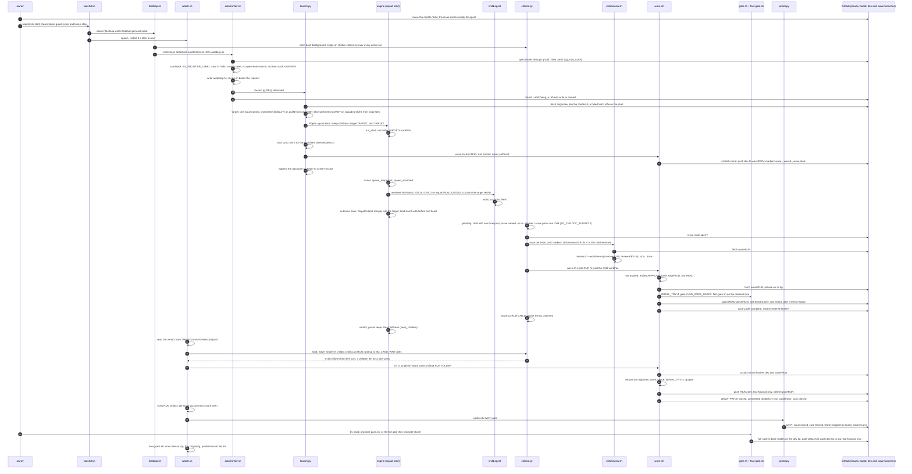
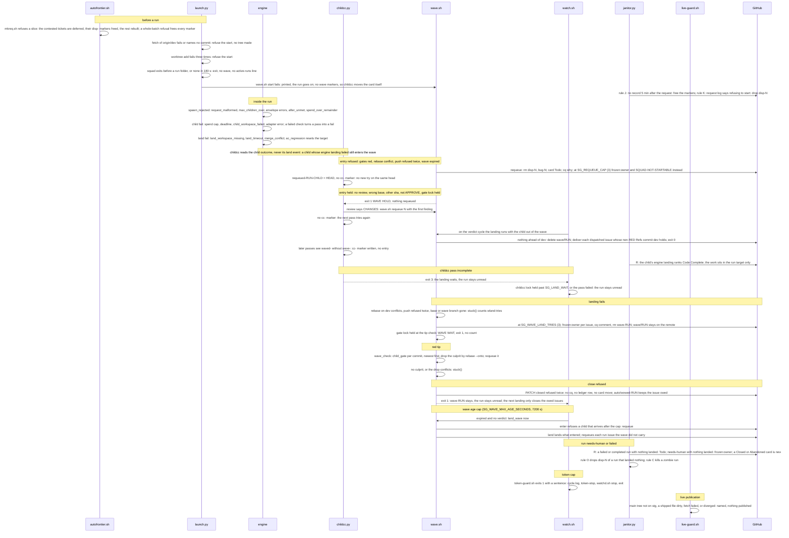

# One issue through the autonomous loop

The trip of one issue from a Todo card to Closed in `dev`: every actor, what each reads and writes, and the failure paths. The doc describes what the code does, defects included, in neutral words. A defect is tracked as an issue, never here. References name a file and a function or step; the code is the source of truth.

Source: `contrib/squad-goal/scripts/*` (live copy `~/.claude/skills/squad-goal/scripts`) and the engine `squad/`. State: `$SG_STATE` (`~/.cache/squad-goal/agent-squad`).
Profile for this repository: `SG_BASE=dev`, `SG_FORK_DIR=$SG_CHECKOUT`, `SG_FORK_BRANCH=gui/%n`, `SG_PROMOTE_PROOF=local`, `SG_BOARD_VOCAB=shipped`.
Shipped columns (`board-definition.json`): Backlog, Todo, Doing, Code Review, Code Complete, Pushing, Testing, Closed, Abandoned. Blocked is no column: it is the `frozen:owner` label over the column the work reached (`board_columns.py`).

`watchd.sh` supervises two lanes:

- **Fast lane** (`fastloop.sh`, every `SG_FAST_INTERVAL` s, 120 by default). Each beat: start one `childcc.py` pass in the background under the `single.sh childcc` lock, unless the pass this lane started still lives; then start `autofrontier.sh` and `autobug.sh` detached. A lane whose supervisor died exits.
- **Slow lane** (`watch.sh`, about 90 s a cycle). Order: token guard; verdicts and wave landings; stall watchdog; `reconcile.py` (every eighth cycle, detached); `branchland.sh`, `branchreviewpass.sh`, `branchfixpass.sh` (detached, each under its own lock, skipped when `SG_LAND_PAUSED` is set); `childcc.py`, `autofrontier.sh`, `autobug.sh` only when the fast lane is down; `autohunt.sh`; `heartbeat.sh`; `wtclean.sh` (every third cycle); `janitor.sh`; `live-guard.sh`; `vendor-guard.sh`.

No cycle step promotes `dev` to `stg`. The owner starts each promotion (ADR-0145 rule 3).

An arrow to `GitHub` is a fetch, a push or an API call. A review, a rebase, a gate and a scratch clone run on the local machine.

## 1. Happy path

## 2. Step table

The column is the one the writer asks for. A board write that the API refuses leaves the card where it was: the wave entry drops the refusal; the frontier, autobug and the wave landing name it.

| step | actor | reads | writes | column asked |
|---|---|---|---|---|
| 1 | owner | - | card to Todo; `watchd.sh start` (watchd.pid, watch.log) | Todo |
| 2 | fastloop.sh | `SG_FAST_INTERVAL` (`env.sh`); its own childcc pid | fastloop.pid every beat; one background childcc pass; both dispatch passes, detached | - |
| 3 | autofrontier.sh | open issues (ghcall, one aggregate read); Todo cards; labels: needs `SG_FRONTIER_LABEL`, skips the bug label and `SG_FRONTIER_SKIP_LABELS` (spec, needs-owner, needs-ratification, needs-info, frozen:owner, frozen:dependency, wontfix); disp-/bug- markers; live issues in active runs (`startability.sh`); remote work branches; `stack.sh`; caps, envelope and `fundroom.py` | auto/disp-N; req/NAME.body; mkreq.sh request; cq comment; card Doing | Doing |
| 3b | autobug.sh | the same, over bug issues (go label and Todo card too) | auto/bug-N; card Doing, and the bug board when `SG_BUG_PROJECT` is set | Doing |
| 4 | launch.py | `origin/$SG_BASE`, fetched now (`_landing_base`); the request's issues (`_issue_named`) | target: the issue worktree `worktrees/child/gui-N` when the request names one issue (`_issue_worktree`; a reused tree is reset to the base, extra commits kept on `refs/squad/leftover/*`, a dirty tree falls back), else its own `worktrees/run/KEY` on `squad/run/KEY` (`_run_worktree`); the engine process with `--keep-children`; `TARGET/runs/RUN/request.txt`, `launch.log`; one active-runs.txt line, absolute | Doing |
| 5 | wave.sh start | origin/dev, origin/wave/RUN (scratch clone) | remote wave/RUN; auto/wave-RUN, waved-RUN, wave-start-RUN | Doing |
| 6 | engine router | request text | record: spawn_requested, spawn_accepted | Doing |
| 7 | child agent | its worktree `RUN/ws/LOGICAL-CHILD`, cut from the target HEAD (`Children.worktree`) | commits "Refs #N" on `squad/RUN_ID/SLUG`; no push | Doing |
| 8 | engine Dispatch.land | child outcome pass; workspace exists | merge into the target branch; land event with `effect.before` and `head` | Doing |
| 9 | engine verdict | record fold | verdict; `prune` keeps child trees for a `keep_children` run | Doing |
| 10 | childcc.py | active runs, or the run watch.sh hands it; spawn_accepted and outcome pass; issue state (gh); wave-/waved- markers; card column for a backfill; requeued-, rvd- markers; auto/childcc-cursor, childcc-round | rvd-RUN-CHILD (head and pid); cc-RUN-CHILD; cursor and round; cq comment; card Code Complete only for a run with no wave; exit 3 when children wait | Code Complete (no wave) |
| 11 | childreview.sh | child HEAD; origin/wave/RUN; review chain (step 11b) | review-KEY.md, .sha (review.sh), .base; cq status comment | - |
| 11b | review.sh | `review_models` of the `models.json` beside the script (the live copy is machine config), in config order (`review_order: config`) | the first model that answers with a verdict wins. Skipped: codex while `$SG_SHARED/codex-limited` holds a future time; gemini (agy) while `agy-limited` does; an `anthropic_models` entry while `quota-guard` exists; a model switched off in the hub; a model outside its `hours` window | - |
| 12 | wave.sh enter | wave-start-RUN age; review-KEY.{md,base,sha}; origin/wave/RUN, rebased on before the gates; `SG_WAVE_GATES` | gate-status fast line (gate.sh); remote wave/RUN tip; card Code Complete; auto/entered-RUN-N | Code Complete |
| 13 | watch.sh | verdict in the record; wave-RUN marker; wave age (`wave.sh expired`) | wland-RUN and its `.pass`/`.left` marks, transient; watch-seen.txt | - |
| 14 | wave.sh land | origin/dev, origin/wave/RUN; `Refs #N` in commits ahead of dev; the run record (`run_issues`) for a capped or empty wave; auto/wowed-RUN | remote dev tip; wave/RUN deleted; wave-start-, wland-tries- removed; issues closed; landed.tsv; cq delivery; card Closed; wave-RUN removed once every issue closed | Closed |
| 15 | GitHub CI | push to dev (`ci.yml`) | check runs on the dev tip | - |
| 16 | wtclean.sh (every third cycle) | child trees under `*/runs/RUN/ws/*`; verdict or zombie; wave hold (`wave-RUN`, capped at `SG_WAVE_HOLD_MAX_SECONDS`); clean tree; HEAD in the base or on a remote or other branch; issue trees under `worktrees/child/*` | removes those trees and throwaway branches; wt tally | - |
| 17 | janitor.py R | run records (active runs and run folders under the checkout, `worktrees/run/*` and `worktrees/child/*`); entered- markers; issue state; board cards, read once; remote branches; review files | board PATCH only on a mismatch, highest rank wins; Run fields; cycle.log | Closed |
| 18 | owner | the dev tip | `promote-pass.sh`: full suite in a clean clone under the gate lock (try mode), gate-status-full, commit status `squad/full-proof`, then `promote-stg.sh` | - |
| 19 | promote-stg.sh | gate-status-full (`SG_PROMOTE_PROOF=local`) or the dev tip's CI (`ci`), under the gate lock | stg ref, fast-forward only; promote.log once per tip and reason | - |
| 20 | live-guard.sh | main tree branch is stg and clean; fetch origin/stg; `publish-live.sh --check` | ff of the main tree; the file list into `~/.claude/skills/squad-goal` | - |

### Run folders

A loop run keeps its folder inside its target: `worktrees/child/gui-N/runs/RUN` or `worktrees/run/KEY/runs/RUN`. The owner's checkout is never written. active-runs.txt holds the absolute path. The loop consumers read every place a run folder can be: `<checkout>/runs`, `worktrees/run/*/runs`, `worktrees/child/*/runs` (`tokens.py`, `janitor.py`, `health.sh`, `hub.py run_roots`, `wtclean.sh`).

### The childcc pass

One pass works at most `SG_CHILDCC_BUDGET` children (1 by default). A child costs budget only when its entry reaches the review and the gates. A closed issue, a landed wave, a backfill skip and a requeue held on the same head cost nothing. The pass starts after the child that `auto/childcc-cursor` names. `auto/childcc-round` holds the children worked since the last complete pass. A pass that leaves a child with no turn in the round exits 3. On 3, `land_wave` defers the landing and keeps the run unread.

### Gate lock

`gate.sh` takes the machine-wide `gate` lock through `serial.sh`. The wave entry and the wave tip check take it in try mode (`SERIAL_TRY=1`): a held lock exits 73 at once, never queued, and counts nothing toward `stuck`. The entry prints `WAVE HOLD` and the child enters on a later pass. The landing prints `WAVE WAIT` and the wave lands on a later cycle. `promote-pass.sh` takes the lock in try mode too. A hand-started gate waits.

### Spec cards

A spec is never work (ADR-0142). `/to-spec` does not label it `ready-for-agent`, and the frontier skips the `spec` label. The janitor folds a spec's column over its sub-issues (rank 15, forward only, nothing below Doing). When the owner moves a spec card to Todo, the janitor moves each open sub-issue whose card is in Backlog or has no column to Todo (rank 12). A spec with at least one sub-issue, all closed, is closed with one comment.

## 3. Failure paths

## 4. Edges the code leaves open

- An empty wave returns before the age-cap requeue. A capped run whose children never entered gets no requeue for an issue that dev does not hold.
- No step removes a run worktree `worktrees/run/KEY` or its branch `squad/run/KEY`. `wtclean.sh` removes child trees under its `runs/RUN/ws` and the issue trees under `worktrees/child`.
- The wave entry drops the output of its Code Complete board write, so a refused write is not named.
