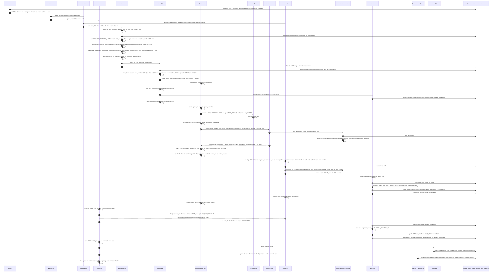

# One issue through the autonomous loop: sequence and profile

The trip of one issue from a Todo card to Closed in `dev`: every actor, what each reads and writes, and the failure paths. The doc describes what the code does, defects included, in neutral words. Section 0 is the profile: the measured time of each step and the hot spots, each with the issue that tracks it. A defect is tracked as an issue, never here. References name a file and a function or step; the code is the source of truth.

Source: `contrib/squad-goal/scripts/*` (live copy `~/.claude/skills/squad-goal/scripts`) and the engine `squad/`. State: `$SG_STATE` (`~/.cache/squad-goal/agent-squad`).
Profile for this repository: `SG_BASE=dev`, `SG_FORK_DIR=$SG_CHECKOUT`, `SG_FORK_BRANCH=gui/%n`, `SG_PROMOTE_PROOF=ci`, `SG_BOARD_VOCAB=shipped`.
Shipped columns (`board-definition.json`): Backlog, Todo, Doing, Code Review, Code Complete, Closed, Abandoned. Blocked is no column: it is the `frozen:owner` label over the column the work reached (`board_columns.py`).

`watchd.sh` supervises two lanes:

- **Fast lane** (`fastloop.sh`, every `SG_FAST_INTERVAL` s, 120 by default). Each beat: start one `childcc.py` pass in the background under the `single.sh childcc` lock, unless the pass this lane started still lives; then start `autobug.sh` and, after it ends, `autofrontier.sh`, detached. A new Todo card in the hub's board cache ends the wait early. A lane whose supervisor died exits.
- **Slow lane** (`watch.sh`; the steps of one cycle run in order, and the measured cycle is in section 0). Order: token guard; verdicts and wave landings; stall watchdog; `reconcile.py` (every eighth cycle, detached); `branchland.sh`, `branchreviewpass.sh`, `branchfixpass.sh` (detached, each under its own lock, skipped when `SG_LAND_PAUSED` is set); `promote-pass.sh` (detached under `single.sh promote`, with `SG_PROMOTE_PROOF=ci`, past the quiet window since the latest landing); `childcc.py`, `autobug.sh`, `autofrontier.sh` only when the fast lane is down; `autohunt.sh`; `heartbeat.sh`; `wtclean.sh` (every third cycle); `janitor.sh`; `live-guard.sh`; `vendor-guard.sh`.

Each dispatch pass first runs the stops in `ghcall.sh`, in order. Each stop prints one line, writes it to cycle.log, and the pass dispatches nothing:

- `gh_loop_stop`: an open issue carries `loop-bug`, bare or prefixed (ADR-0146); the pass stops and asks `watchd.sh` for the drain. `childcc.py` stops on `loop-bug:dispatch`, `loop-bug:landing` and `loop-bug:infra` only, from the one list `ghread.LOOP_STOP_LABELS` (`loop_defect`): it starts no review, fix run or entry, exits 0 when every pending child is in its wave, and exits 3 while a child of a wave that is not past its age cap is out of it.

The landing has one stop, `gh_land_stop`: an open issue carries `loop-bug:landing`, which names a defect in the landing path. `land_wave` (`watch.sh`) and `branchland.sh` then land nothing, and the run stays unread. A plain `loop-bug` never stops a landing (ADR-0146 decision 3).
- `gh_dispatch_hold`: the count in `childcc-waiting` is over `SG_DISPATCH_MAX_WAITING` (unset: no hold; a count over 30 min old: no hold).
- `gh_disk_stop`: the volume of `$SG_STATE` or `$TMPDIR` has less than `SG_MIN_FREE_GB` GiB free (20 by default).
- `gh_bug_first` (`autofrontier.sh` only): `bugs-waiting`, which `autobug.sh` writes, is over 0 and under 30 min old.

No cycle step promotes `dev` to `stg`: the proof's full suite would hold the gate lock. The loop promotes on the proof of the tip, and moves `main` to the `stg` sha whose complete CI tier is green (ADR-0145 rule 3, ADR-0173).

An arrow to `GitHub` is a fetch, a push or an API call. A review, a rebase, a gate and a scratch clone run on the local machine.

## 0. Profile: where the time goes

Read this section as a profiler's hot-spot list. The step numbers are those of the step table in section 2. Each number is a measure of this repository's loop on one machine (8 cores, 16 GB), over the window its row names. The numbers change with each fix: measure again before a decision (see "How to measure").

### The trip of one issue

| stage | steps | median | p90 | what the time is |
|---|---|---|---|---|
| Queued before the run | 1, 2 | - | - | the card's Todo move to the run's start, from the board's transitions |
| Wait for a dispatch | 2, 3 | one fast-lane beat (120 s) | a run slot (`no slot`) | the run cap is the owner's lever; a full machine is healthy backpressure |
| Router | 6 | 31 s | - | one model call |
| Child coding | 7 | 2140 s | 7200 s | model turns, and the child's own test runs. The largest stage of a trip |
| Between two children | 7, 8 | - | - | the uncovered time between two child spans: a wave entry or a slot wait inside the run |
| Review round | 7b, 11 | 42 s | - | one model call per round; a fix round adds one child entry |
| Engine gates | 9 | 78 s | 756 s | the run's final gate; the p90 is a wait for a gate slot or a loaded machine |
| Wave entry gate | 12 | 469 s (pass) | 924 s | `fast-gate.sh` on the rebased tree, a delta selection |
| Wait for the slow lane | 13 | 271 s | 489 s | the verdict is read once a `watch.sh` cycle |
| Wave landing | 14 | one tip gate | - | the same gate again on the wave tip |
| Promotion to `stg` | 15, 18, 19 | CI fast tier | - | starts past the quiet window since the last landing |
| After the verdict | 15 to 19 | - | - | the run's verdict to the card's Closed move, from the board's transitions |

The live form of this table is the **trip bar** of the hub's `Loop` tab: one stacked bar over the window the tab's picker names (1 hour, 24 hours or 48 hours), one segment and one row per board column, in the board's order: `Todo`, `Doing`, `Review`, `Gating`, `Landing` and `Closed`. A column that holds two stages, `Todo` with the queue and the dispatch wait, `Doing` with coding and the span between two children, reads its larger stage's median and p90, and the other stage stands beside it in the same cell with its own median; the segment carries the sum of the column's stages, so no measurement leaves the panel. The hub's `GET /api/profiler` answers it as `trip` (`hub_profiler.trip`), folded from the run records, `gate-history` and the board's transitions of the card each run works; the payload carries the six `columns` and keeps the flat `stages` list of the older wire beside them, one row per record stage, so a reader of that shape still reads it; a window with fewer than three deliveries draws no bar and says so. The bar reads the stages the records hold: the wait for a slot before a run's first call, the child's coding, each review round, each gate, and the merge to the verdict; the card's transitions add the waiting outside the run, the queue before it, the gaps between two children and the wait past the verdict (`trip_spans`). A run that names no card reads no column the card alone fills, so its `Todo` row reads the dispatch wait alone and its `Closed` row reads nothing. A percentile is read on the `(n - 1)` weight (`hub_profiler.percentile`), so the bar and this table agree on one definition.

### Hot spots

Sorted by the time each one costs the loop. "Fix" names the issue that tracks it.

| # | hot spot | measure | cause | fix |
|---|---|---|---|---|
| 1 | Runs that deliver nothing | 28 of 35 runs failed in 48 h; child coding totals 110689 s | A failed run's coding time is lost and the issue starts again. Reasons: killed with no process (8), deadline (5), child ended early (2), review fix failed (2), red final gate (2), no gate slot | each reason has its own issue; the largest cost in the loop |
| 2 | Gates that end unproven | 34 of 110 gates in 24 h, 27978 s of 60451 s; median 901 s, the deadline | The suite did not finish inside the bound. The whole fast battery takes 114 to 198 s alone, so the rest is machine load. Two orphan loops from one shell suite caused the load of the measured day (hot spot 3) | #1742; the load labels of #1691 tell a loaded gate from a slow one |
| 3 | Orphan processes of a test suite | 113 to 130 new processes a second; load 50 to 84 with 3.4 cores busy; 7 h 45 min | A shell suite started the real `watch.sh` from a fixture copy and ended only its subshell | #1742 |
| 4 | The janitor pass | 291 s mean, 70 % of the slow lane (108598 s of 153944 s over 371 cycles) | One GitHub read per issue of every run folder: 155 reads, 96 s of a 181 s profiled pass, with 11 issues open | #1744 |
| 5 | The board read, twice a janitor pass | 32 s of the 181 s pass | `read_all` and `holders` each read the board | #1747 |
| 6 | The hub under load | 44 % of a core (mean), peaks of 80 % | One process-table scan every 5 s for each profile while the machine is warned, and a ledger read for the footer | #1746 |
| 7 | File indexing | about 0.7 core (`mds`, `fseventsd`) | The file churn of worktrees and run folders | none; it falls with hot spot 3 |
| 8 | The cycle log cannot name a step | every step reads `bash` | `tm` logs the first word of the command | #1745; a wall-time view in the hub (#1748) needs it |

Three rules follow from the list:

- A slow gate is first a loaded machine. Read the load at the gate's start and finish (fields 15 and 16 of `gate-history`) before the bound or the selection is changed.
- The slow lane's cycle is the floor of every verdict read, wave landing and promotion step. A step that waits on GitHub costs wall time and no CPU, so a CPU profile does not show it; `cycle.log` does.
- A failed run costs more than every gate and cycle together. A fix that removes one failure reason is worth more than a faster step.

### How to measure

- **Live, by CPU:** the hub's `Loop` tab. Its `CPU sampling` switch is off by default; on, the hub reads the process table every second and folds the loop of this profile into a hot-spot tree, with every process outside the loop in one context row.
- **Slow lane, by wall time:** `$SG_STATE/cycle.log`. A line `HH:MM:SS <step> <secs>s` is a step of 5 s or more; `CYCLE <secs>s` ends each cycle.
- **Gates:** `$SG_STATE/gate-history`, one line a gate run: kind, scope, stage, outcome, the machine load at its start and finish, the entry mode (`gated`, `reused` or `skipped`), the tree it read, the seconds it waited for the lock and its slots, its wall time, the CPU its command spent, and whether its verdict was reused. A gate a green verdict answers is one line too, mode `reused`. `gate_load_set.py` prints the labeled rows; `hub_profiler.gate_queue` answers over one window what share of the gate stage is lock wait and how many distinct trees paid a gate.
- **Runs:** each `record.jsonl` under `worktrees/*/*/runs/run-*/`: the time between `run_start`, `spawn_accepted`, the child's outcome, each `review_round`, each `gate_start` and `gate_result`, and the verdict.
- **One pass of one script:** `JANITOR_DRY=1 python3 -m cProfile -s cumtime janitor.py`. A dry pass writes nothing.
- **Process churn:** count new pids a second by parent tree. A process table read every second misses a process that lives for less, and such processes were the cause of hot spot 3.

## 1. Happy path



## 2. Step table

The column is the one the writer asks for. A board write that the API refuses leaves the card where it was: the wave entry drops the refusal; the frontier, autobug and the wave landing name it.

| step | actor | reads | writes | column asked |
|---|---|---|---|---|
| 1 | owner | - | card to Todo; `watchd.sh start` (watchd.pid, watch.log) | Todo |
| 2 | fastloop.sh | `SG_FAST_INTERVAL` (`env.sh`); its own childcc pid; Todo cards in the board cache | fastloop.pid every beat; one background childcc pass; autobug then autofrontier, detached | - |
| 3 | autofrontier.sh | the four stops (`ghcall.sh`); open issues (ghcall, one aggregate read); Todo cards; labels: a Todo card with no holder, writes `SG_FRONTIER_LABEL`; skips the bug label and `SG_FRONTIER_SKIP_LABELS` (spec, needs-owner, needs-ratification, needs-info, frozen:owner, frozen:dependency, wontfix); disp-/bug- markers; live issues in active runs (`startability.sh`); remote work branches; `stack.sh`; spec links and bodies (`siblings.py`, `cluster.py`, ADR-0150), over every pick of the pass; acceptance commands (`acpaths.py`); caps, envelope and `fundroom.py`. One run per free run slot, never more runs than children; the children are dealt over the runs in turn, and no run takes more than its envelope | auto/disp-N; req/NAME.body and one mkreq.sh request per run; cq comment; card Doing | Doing |
| 3b | autobug.sh | the same, over bug issues (a Todo card with no holder too; `needs-info` is a skip floor), with no `gh_bug_first` stop | auto/bug-N; bugs-waiting (startable bugs left with no run); card Doing, and the bug board when `SG_BUG_PROJECT` is set | Doing |
| 4 | launch.py | `origin/$SG_BASE`, fetched now (`_landing_base`); the request's issues (`_issue_named`) | target: the issue worktree `worktrees/child/gui-N` when the request names one issue (`_issue_worktree`; a reused tree is reset to the base, extra commits kept on `refs/squad/leftover/*`, a dirty tree falls back), else its own `worktrees/run/KEY` on `squad/run/KEY` (`_run_worktree`); the engine process with `--keep-children`; `TARGET/runs/RUN/request.txt`, `launch.log`; one active-runs.txt line, absolute | Doing |
| 5 | wave.sh start | origin/dev, origin/wave/RUN (scratch clone) | remote wave/RUN; auto/wave-RUN, waved-RUN, wave-start-RUN | Doing |
| 6 | engine router | request text | record: spawn_requested, spawn_accepted | Doing |
| 7 | child agent | its worktree `RUN/ws/LOGICAL-CHILD`, cut from the target HEAD (`Children.worktree`) | commits "Refs #N" on `squad/RUN_ID/SLUG`; no push | Doing |
| 7b | engine Dispatch.rounds, runreview.sh | the dispatch node's `review` gate (`review_gate` in `router.graph.json`, argv `SG_RUN_REVIEW`); the run's wave marker; one `reviews` slot (`caps.sh`, `SG_RUN_REVIEW_WAIT`); a fix grant held from the run budget | one `review_round` event per round (head, verdict, offered, and `repeated` when a failed fix entry left the review standing), and one `review_try` event per try with no verdict. Exit 0 approve; 3 no review here (no issue, no wave); 5 try again (no slot, no verdict): the round tries again inside the gate deadline, and at the deadline the child is held (`review_deadline`); 4 fix: CHANGES with a fix grant on offer and findings that changed (`revformat.py --stall`, `runfix` markers), and the child runs entry n+1 in its worktree; identical findings twice move entry n+1 to the next coder of the run's chain, and a fix entry that ends with no artifact (`review_streak.NO_ARTIFACT`) is the finding unanswered, so the coder moves at once, the review stands, and the next entry answers it (ADR-0151); 1 hold: BLOCKED, CHANGES with no offer, or `SG_RUN_FIX_STALLS` (3) rounds with the same findings: `wave.sh requeue` with the verdict line and every blocking finding, and the issue's ledger fact `requeue` holds the head; a signal ends the review: `killed`, an infrastructure stop with `review_killed`, and the round carries the signal and exit status | Doing |
| 8 | engine Dispatch.land | child outcome pass; workspace exists; the last review round | approve or no review: merge into the target branch. Hold: no merge, reasons `review_held`, `review_deadline`, `review_killed` or `review_fix_failed`. Land event with `effect.before`, `head`, `review`, `rounds` | Doing |
| 9 | engine verdict | record fold | verdict; `prune` keeps child trees for a `keep_children` run | Doing |
| 10 | childcc.py | open `loop-bug` issues; active runs, or the run watch.sh hands it; spawn_accepted, the last passing outcome per child, land events (outcome and review verdict); in a live run, the dispatch node's `review` key in the run's `graph.json` and the child's `review_*` events: a run that reviews its own children keeps the child out of the pending list until its land event or the run's verdict (#696); issue state (gh); wave-/waved- markers; card column for a backfill; the issue's `requeue` fact (the head the run requeued it on); rvd-, apphold-, holds-, ccfix- markers; auto/childcc-cursor, childcc-round | rvd-RUN-CHILD (head and pid); crv-RUN-CHILD and card Doing to Code Review when a review starts or a child waits; cc-RUN-CHILD; one fix run on CHANGES (childfix.sh: ccfix-RUN-CHILD, ccfixrun-FIXRUN, ccfix stall markers, a line in wave-pause-RUN); cursor and round; childcc-waiting; childcc-now.json; cq comment; card Code Complete only for a run with no wave; exit 3 when children wait | Code Review; Code Complete (no wave) |
| 11 | childreview.sh | child HEAD; origin/wave/RUN; origin/dev (the diff base is the newer merge-base, #655); review chain (step 11b) | review-KEY.md, .sha (review.sh), .base; cq status comment. Exit 1 when no verdict: childcc drops its rvd- claim | - |
| 11b | review.sh | `review_models` of the `models.json` beside the script (the live copy is machine config), in config order (`review_order: config`); review-KEY.lock | the first model that answers with a verdict wins (see Review of one branch). Skipped: codex while `$SG_SHARED/codex-limited` holds a future time; gemini (agy) while `agy-limited` does; grok while `grok-limited` exists; an `anthropic_models` entry while `quota-guard` exists; a model switched off in the hub; a model outside its `hours` window | - |
| 12 | wave.sh enter | the run's last verdict after its last start or resume: failed with an `ac-verify:` reason refuses the child (`gate_failed`, #694; `ac-verify:no_ac_commands` enters); wave-start-RUN age less its pause (`wavepause.py`: review rounds and fix entries in the run record, and the fix runs wave-pause-RUN names; an expired wave takes only a head the review approved against it); review-KEY.{md,base,sha}; origin/wave/RUN, rebased on before the gates; `SG_WAVE_GATES` | gate-status fast line and one `gate-history` line with the load at the gate's start and finish and the entry mode, `gated` or `reused` (gate.sh); remote wave/RUN tip; card Code Complete, a refused write named (`board_write`); the ledger fact `entered`, which every later event of the run keeps. A hold or a refusal writes the ledger fact `held` or `refused` with its cause; a refusal requeues the issue, counted | Code Complete |
| 13 | watch.sh | verdict in the record; wave-RUN marker; wave age less its pause (`wave.sh expired`) | wland-RUN and its `.pass`/`.left` marks, transient; watch-seen.txt | - |
| 14 | wave.sh land | origin/dev, origin/wave/RUN; `Refs #N` in commits ahead of dev; the run record (`run_issues`) and the ledger's `entered` facts for a capped or empty wave; the ledger's `owed` facts of the run (`issue_ledger.py owed`) | remote dev tip; wave/RUN deleted; wave-start-, wave-pause- removed; issues closed; landed.tsv; the ledger facts `landed` (the issue's work is in the base) and `delivered`; cq delivery; card Closed; wave-RUN removed once every issue closed. A landing that fails on a cause a repeat does not change writes the ledger fact `stuck` for each issue the wave carries; a close that fails twice writes `owed` | Closed |
| 15 | GitHub CI | pull request dev to stg (`ci.yml`) | check runs on the pull request | - |
| 16 | wtclean.sh (every third cycle) | child trees under `*/runs/RUN/ws/*`; verdict or zombie; wave hold (`wave-RUN`, capped at `SG_WAVE_HOLD_MAX_SECONDS`); clean tree; HEAD in the base or on a remote or other branch, else the unpushed work goes to `refs/salvage/wt/<tree path>` and nothing is pushed; issue trees under `worktrees/child/*`; run trees `worktrees/run/KEY` whose every run ended for good (`completed`, or `failed` with no remains); active-runs.txt lines | removes those trees and throwaway branches, `squad/run/KEY` after its tree; wt tally; drops the active-runs.txt line of an ended run (a verdict after its last `run_start` or `resume`) whose wave is not open (no `wave-RUN`) after `SG_RUN_LINE_SECONDS` (3600) idle with no process in its folder, whatever keeps its tree; the tree stays for a resume or the owner (#693, #708). No resume adds the line back | - |
| 17 | janitor.py R | run records (active runs and run folders under the checkout, `worktrees/run/*` and `worktrees/child/*`); the ledger's `entered` and `landed` facts; issue state and labels, from `issue-facts.json` and one list read of the issues that changed since the last pass (an issue the file does not hold, or holds for over a day, is read by itself); board cards, read once; remote branches; review files | board PATCH only on a mismatch. An issue follows the newest run that holds it; rank orders the signals of that run only. A child done and not in the run's open wave ranks Code Review (35). A landing is delivered work only when a landing pass wrote the issue's ledger fact `landed` (`wave.sh`, `branchland.sh`, ADR-0149); rule R reads that fact, never a run's land heads, so a local land commit that reached no base delivers nothing (#691). A run that cut no wave delivers by its own land event. Run fields; frozen:owner for a Blocked want; cycle.log; `issue-facts.json`, atomic, never in a dry pass | Code Review; Closed |
| 18 | watch.sh (`single.sh promote`, past the quiet window, bounded by `SG_PROMOTE_MAX_DEFER`) | the dev tip; its CI check-runs on the cycle path (`SG_PROMOTE_PROOF=ci`) | `promote-pass.sh`: the CI proof, then `promote-stg.sh`, which takes the gate lock for the one pull-request merge. The local path only (`SG_PROMOTE_PROOF=local`) runs the full suite in a clean clone under the proof lock, writes gate-status-full and the `squad/full-proof` commit status | - |
| 19 | promote-stg.sh | gate-status-full (`SG_PROMOTE_PROOF=local`) or the dev tip's CI (`ci`), under the gate lock | the open dev → stg pull request, merged; no push to stg; promote.log once per tip and reason | - |
| 20 | live-guard.sh | main tree branch is stg and clean; fetch origin/stg; `publish-live.sh --check`; live `PUBLISHED`, `scripts/models.json` digest and `scripts/*.bak-*`; `driver.sha` (written by `watchd.sh start`) | ff of the main tree; the file list and `PUBLISHED` (source HEAD sha) into `~/.claude/skills/squad-goal`; each issue a published `Closes #n` names, closed with one comment (sha, publish time) (#732); `live-guard.models`, `.clutter`, `.restart` (each note named once) | - |

### Run folders

A loop run keeps its folder inside its target: `worktrees/child/gui-N/runs/RUN` or `worktrees/run/KEY/runs/RUN`. The owner's checkout is never written. active-runs.txt holds the absolute path. The loop consumers read every place a run folder can be: `<checkout>/runs`, `worktrees/run/*/runs`, `worktrees/child/*/runs` (`tokens.py`, `janitor.py`, `health.sh`, `hub.py run_roots`, `wtclean.sh`).

### The childcc pass

One pass works at most `SG_CHILDCC_BUDGET` children (1 by default). A child costs budget only when its entry reaches the review and the gates. A closed issue, a landed wave, a backfill skip and a requeue held on the same head cost nothing. The pass starts after the child that `auto/childcc-cursor` names. `auto/childcc-round` holds the children worked since the last complete pass. A pass that leaves a child with no turn in the round exits 3. On 3, `land_wave` defers the landing and keeps the run unread.

A run reviews its own children when its dispatch node has a `review` key in the run's `graph.json`, or the record holds a `review_*` event for the child. While such a run is live, its passed child is not pending until the child's land event: the run still reviews it, fixes it or lands it. A finished run's children are worked as before (#696). A child the run approved enters with no second review. If its entry still holds it, `apphold-RUN-CHILD` makes the pass review it from then on. A child that `WAVE HOLD` keeps out is not counted as visited, so the wave waits for it until its age cap. A review hold counts per head in `holds-RUN-CHILD`. At `SG_HOLD_TRIES` (3) holds on one head, the pass requeues the issue with the hold reason. `review.sh` saves a CHANGES with no Blocking finding and at least one Debt finding as `VERDICT: APPROVE`, so it enters with no fix run. A review that says CHANGES starts one fix run in the child's kept worktree, which is the run's target, so its final gate reads the child's files (`childfix.sh` sets `SG_RUN_TARGET` for `launch.py`, `ccfix-RUN-CHILD` names its folder, `ccfixrun-FIXRUN` keeps the pass off its children). The child is held while the fix run has no verdict, and its new head is reviewed again. If the findings do not change after a fix run (`revformat.py`, `ccfix` stall markers), the pass requeues the issue once with the first finding, and with the fix run's last turn when its record kept one (ADR-0151). A child whose engine landing failed is requeued once with that reason and never enters. A child its run already requeued (the issue's `requeue` fact, ADR-0149) gets its cc- marker and nothing else.

### Review of one branch

`review.sh` takes the lock `review-KEY.lock` (flock on fd 9), waiting up to `SG_REVIEW_LOCK_WAIT` s (3600). `runreview.sh` and `childcc.py` can review the same child, so the second one waits. A verdict the first one wrote for the same head is reused, and no model is called. Each try writes private files `review-KEY.md.PID*`. Only a verdict, or the BLOCKED line, reaches `review-KEY.md`, by a rename. A head that moves during the review publishes `VERDICT: BLOCKED (... head moved during the review)`. When every model fails, it publishes `VERDICT: BLOCKED (every review model failed)` and exits 1. An answer outside the checklist shape (`revformat.py`) is MODEL_FORMAT. The same model gets one repair try with the complaint (for a JSON answer, the parser's error), with one or several reachable models; a failed repair ends that model's turn. A `review_no_tools` model gets its repair turn inside its direct `/v1/messages` call instead. A model whose tries all failed hands the review to the next model, and that turn queues one `MODEL_SWITCH` status that names both. Status files carry the model and the try in their names. A grok 402 writes `grok-limited`, which only the owner removes.

### Requeue counts

Each issue has one ledger file, `$SG_STATE/state/<owner>__<repo>__<n>.json`, keyed `<owner>/<repo>#<n>`. `issue_ledger.py` is its only writer (atomic write under a lock per issue). `wave.sh requeue` counts through it (`count`, `ledger fail`) in two ledgers. A loop-caused reason (`loop_caused`: a wave that landed without the child, an adapter error, a merge or rebase conflict, a disk stop, a review with no ruling or a moved head) counts in `loop`. At `SG_LOOP_REQUEUE_CAP` (6) `loop_stop` adds `needs-owner` and queues SQUAD-NEEDS-HUMAN. It writes no card; janitor rule R adds `frozen:owner` over the column the card reached. Any other reason counts in `own`. At `SG_REQUEUE_CAP` (3) `stop` adds `frozen:owner` and queues SQUAD-NOT-STARTABLE. One run counts once. A new non-RED `Refs #N` commit in the base starts the count again. A requeue the age cap makes (`cap`) counts in neither. A missing ledger file of a new issue reads as 0 attempts.

Every write goes through one transition function, `transition` (ADR-0149): `fail`, `stop`, `wave` (with `landtry` and `owe`) and `rearm` are its events. A wave event (`issue_ledger.py wave KEY RUN STATE CAUSE [keep]`) sets the run's wave fact: `entered`, `held`, `refused`, `stuck` or `delivered`, with its cause. The same state and cause again is a duplicate and writes nothing. A `delivered` run is terminal. `keep` leaves a fact the run already has. An `entered` event also sets the fact's `entered` field, and later events of the run keep it; `issue_ledger.py entered OWNER/REPO` lists each run and issue that has it. janitor.py (rule O, rule R, the delivery hold) and startability.sh (`sg_live_issues`) read it. A failed landing on a cause a repeat does not change is a `landtry` event: the fact is `stuck` and its `tries` grows by one; any other event of the run keeps the tries. An issue a landed wave could not close gets the fact `owed` (`owe`, with the wave and the sha); `owed OWNER/REPO RUN` lists them, and the `delivered` event ends it. The ledger replaced the markers auto/excluded-RUN-N, auto/entered-RUN-N, auto/wland-tries-RUN and auto/wowed-RUN.

A corrupt ledger file holds its issue (ADR-0149 rule 4). `read` gives the state `held` and names the file and the cause. Every writer but `rearm` refuses it and leaves it as it is. autofrontier.sh and autobug.sh skip the issue (`sg_ledger_held`, one `skip` line), `wave.sh` keeps it where it is (`held_out`), and rule O counts nothing for it (`LEDGER-HELD` in cycle.log). It never falls back to the old counters. A missing file holds its issue the same way when an old counter of the issue is there (`requeues-N`, `loopqueues-N` or their `.runs`): `issue_ledger.py migrate KEY` writes those counters into the file once, or `rearm` clears them. An issue with no file and no old counter is new and reads todo.

A ticket whose acceptance commands name a missing repository path is not dispatched (#729). `acpaths.py` reads the code spans of the "Acceptance criteria" section and prints each path that the checkout and the base ref do not hold. A path the ticket names outside that section (under "What to build", "Files:"), a path its acceptance line creates (new, create, add, write) and a test file are not missing. autofrontier.sh and autobug.sh call `sg_ac_refused` (`startability.sh`) after the ledger check: it queues one comment (`SQUAD-AC-MISSING`, auto/acmiss-N keeps the paths so a retry adds none), adds `needs-info`, and logs one `refuse` line. Both passes skip `needs-info`. A check that cannot run refuses nothing.

`issue_ledger.py rearm` clears both ledgers and the wave facts, and keeps a floor (`rearmed`: the rearm time and every run a ledger or a wave fact listed). `fail` and a wave event never count a run on that list (#692). A rearm also writes a fresh file over a corrupt one.

`janitor.py` rule R unholds an issue of a live run whose spawn batch is decided and gave it no child: the card goes to Todo and the dispatch marker goes (#480). A child maps to its issues by its accept line, `Refs #N` included, read with each escaped newline as a newline (`child_issues.plain`, #725). While any child of the run maps to no issue, nothing is unheld.

`janitor.py` rule O counts a run that delivered nothing through `wave.sh fail`, with the run's own review verdict as the kind. When the run's wave landed without the child, the reason names the run's wave fact in the ledger, or `unknown`. It skips a run whose verdict is older than the rearm, and an issue whose child entered the run's wave. It writes `auto/counted-RUN` with the verdict key once every issue of the run is decided, so a later pass reads that run again only after a resume writes a new verdict (#693).

### Gate lock

`gate.sh` takes the machine-wide `gate` lock through `serial.sh`. The wave entry and the wave tip check take it in try mode (`SERIAL_TRY=1`): a held lock exits 73 at once, never queued, and counts nothing toward `stuck`. The entry prints `WAVE HOLD` and the child enters on a later pass. The landing prints `WAVE WAIT` and the wave lands on a later cycle. `promote-pass.sh` takes the lock in try mode too. A hand-started gate waits.

### Fast gate result

`fast-gate.sh` names the failing class on its last line: `lint`, `type`, `collection`, `pytest` with the failed ids, `saturation` or `unknown`. A red that names no failed test is never read as one cause. Failed ids run once more, serially: a pass there is saturation and goes on, a red there exits 1. A `saturation` or `unknown` red is inconclusive, so the battery runs once more. A pass goes on, a defect exits 1, and a second inconclusive result exits 4. Exit 4 holds landing: the wave entry prints `WAVE HOLD` and requeues nothing, the wave tip check blames no child and counts no landing try, and `branchland.sh` runs no rerun and lands nothing. The gate lock stays the one `gate.sh` takes.

A fetch or push of `wave.sh land` that fails on the network (cannot resolve the host, cannot connect, a timeout, a 5xx answer, a TLS handshake) prints `WAVE-NETWORK` and exits 2. It counts nothing toward `stuck` and freezes nothing, so the wave lands on a later cycle. A fetch that answers and lacks the ref still counts.

### Spec cards

A spec is never work (ADR-0142). `/to-spec` does not label it `ready-for-agent`, and the frontier skips the `spec` label. The janitor folds a spec's column over its sub-issues (rank 15, forward only, nothing below Doing). When the owner moves a spec card to Todo, the janitor moves each open sub-issue whose card is in Backlog or has no column to Todo (rank 12). A spec with at least one sub-issue, all closed, is closed with one comment.

### Frontier idle

A frontier pass that holds Todo cards and starts none says so in one line (#733): `FRONTIER idle: N todo, M startable (counts)`. It goes to the pass's output and to cycle.log, because a silent frontier and a stuck one read the same in the log, and the owner found the last stall instead of the loop. The counts name every reason a card waits, in this order: `triage failed`, `held`, `sibling`, `no slot`, `blocked`, `claimed`, `busy`, `not startable`, `skip label`, `ac paths`, `not listed`. A reason no card carries still prints as 0, so the shape of the line never changes, and the counts sum to N. `triage failed` is a card the pass took and dropped because the `ready-for-agent` write on its issue was refused; the next pass retries it. `no slot` is the reason of every card when the machine holds no run slot or no child room, and of the cards past the pass's envelope. The per-card detail, one `FRONTIER why #N: reason` line a card, follows only when the reasons changed since the previous pass: the pass keeps the hash of them in `auto/frontier-why`, and a pass that dispatches removes it. A pass with no Todo card writes no line.

## 3. Failure paths

```mermaid
sequenceDiagram
    participant AF as autofrontier.sh
    participant L as launch.py
    participant E as engine
    participant RR as runreview.sh
    participant CC as childcc.py
    participant WV as wave.sh
    participant W as watch.sh
    participant J as janitor.py
    participant LG as live-guard.sh
    participant GH as GitHub
    Note over AF,L: before a run
    AF->>AF: loop-bug open, too many children wait, disk under the floor, or bugs wait: one line, nothing dispatched
    CC->>CC: loop-bug open: LOOP STOP line, no review, fix run or entry#59; exit 0 when every pending child entered its wave, else exit 3
    W->>W: loop-bug:landing open: LOOP STOP line, land_wave and branchland land nothing, the run stays unread
    AF->>AF: mkreq.sh refuses a slice: the contested tickets are deferred, their disp- markers freed, the rest rebuilt#59; a whole-batch refusal frees every marker
    L->>L: fetch of origin/dev fails or names no commit: refuse the start, no tree made
    L->>L: worktree add fails three times: refuse the start
    L->>L: squad exits before a run folder, or none in 180 s: exit, no wave, no active-runs line
    L->>WV: wave.sh start fails: printed, the run goes on#59; no wave markers, so childcc moves the card itself
    J->>GH: rule J: no record 5 min after the request: free the markers#59; rule K: request log says refusing to start: drop disp-N
    Note over E: inside the run
    E->>E: spawn_rejected: request_malformed, max_children_over, envelope errors, after_unmet, spend_over_remainder
    E->>E: child fail: spend cap, deadline, child_workspace_failed, adapter error#59; a failed check turns a pass into a fail
    E->>E: land fail: land_workspace_missing, land_timeout, merge_conflict#59; ac_regression resets the target
    Note over E,RR: in-run review
    RR->>WV: exit 1: wave.sh requeue N with the verdict line and every blocking finding#59; requeued-RUN-CHILD = head
    E->>E: land fail review_held, review_deadline, review_killed or review_fix_failed: no merge, the worktree stays
    CC->>CC: land fail with requeued- marker: CHILD HELD, cc- marker#59; without it: requeue "its landing failed", cc- marker
    CC->>CC: live run that reviews its children, no land event yet: the child is not pending, so no second review and no fix run (#696)
    Note over CC,WV: entry refused: run failed its final gate (#694), gates red, rebase conflict, push refused twice, wave expired
    WV->>GH: requeue: rm disp-N, bug-N#59; card Todo#59; cq why#59; at a ledger cap NEEDS-HUMAN or STOP instead (Requeue counts)
    CC->>CC: requeued-RUN-CHILD = HEAD, no cc- marker: no new try on the same head
    Note over CC,WV: entry held: no review, wrong base, other sha, not APPROVE, gate lock or gate slots held, gates inconclusive (exit 4)
    WV-->>CC: exit 1 WAVE HOLD, nothing requeued#59; the child stays left, so the pass exits 3
    CC->>WV: SG_HOLD_TRIES review holds on one head: wave.sh requeue N with the hold reason
    CC->>CC: review says CHANGES: childfix.sh starts one fix run in the child's worktree#59; the child is held until its verdict
    CC->>WV: the same findings after a fix run: wave.sh requeue N with the first finding
    W->>WV: at the age cap the landing runs with the child out of the wave
    WV->>GH: nothing ahead of dev: delete wave/RUN#59; deliver each dispatched issue whose child entered or whose non-RED Refs commit dev holds#59; capped: requeue the rest#59; exit 0
    CC->>CC: later passes see waved- without wave-: cc- marker written, no entry
    J->>GH: R: the wave landed without the child: Todo (20)#59; the open wave lacks it: Code Review (35)
    Note over W,CC: childcc pass incomplete
    CC-->>W: exit 3: the landing waits, the run stays unread
    W->>W: childcc lock held past SG_LAND_WAIT, or the pass failed: the run stays unread
    Note over WV,GH: landing fails
    WV->>WV: rebase on dev conflicts, push refused twice, base or wave branch gone: stuck() counts a try in the ledger of each issue of the wave or the run (`landtry`; a network error counts nothing; a wave that names no issue stops at once)
    WV->>GH: at SG_WAVE_LAND_TRIES (3): frozen:owner and card Todo per issue, cq comment, rm wave-RUN#59; wave/RUN stays on the remote
    WV->>WV: gate lock held at the tip check: WAVE WAIT, exit 1, no count
    WV->>WV: tip check inconclusive (fast-gate exit 4): no child blamed, the wave does not land, no count
    Note over WV: red tip
    WV->>WV: wave_check: child_gate per commit, newest first#59; drop the culprit by rebase --onto#59; requeue it
    WV->>WV: no culprit, or the drop conflicts: stuck()
    Note over WV,GH: close refused
    WV->>GH: PATCH closed refused twice: no cq, no ledger row, no card move#59; the ledger fact `owed` keeps the issue owed
    WV-->>W: exit 1: wave-RUN stays, the run stays unread#59; the next landing only closes the owed issues
    Note over W,WV: wave age cap (SG_WAVE_MAX_AGE_SECONDS, 7200 s), paused while a child is in a review round, a fix entry or a childcc fix run
    W->>WV: expired and no verdict: land_wave now
    WV->>GH: enter refuses a child that arrives after the cap: requeue
    WV->>GH: enter still takes a head the review approved against the wave
    WV->>GH: land lands what entered#59; requeues each run issue the wave did not carry, an empty wave too
    Note over W,J: run needs-human or failed
    J->>GH: R: a failed or completed run with nothing landed: Todo#59; needs-human with nothing landed: frozen:owner#59; a Closed or Abandoned card is never frozen
    J->>GH: R: a failed run whose child head is not in origin/dev counts nothing delivered: Todo, never Code Complete (#691)
    J->>J: rule O drops disp-N of a run that landed nothing and counts it (wave.sh fail), once per verdict, never a run before a rearm#59; rule C kills a zombie run
    Note over W: token cap
    W->>W: token-guard.sh over the cap: token-over, one alert, a cycle.log line#59; the loop goes on
    W->>W: last hour over 3x the cap's hourly share, after one hour measured: token-pause#59; autofrontier and autobug start nothing
    W->>W: last hour under the cap's hourly share: token-pause cleared#59; dispatch resumes
    Note over LG: live publication
    LG->>LG: main tree not on stg, a shipped file dirty, fetch failed, or diverged: named, nothing published
    LG->>LG: publish: PUBLISHED holds the source HEAD sha#59; LIVE-GUARD published SHA
    LG->>GH: a published commit carrying Closes #n closes #n, one comment naming sha and publish time#59; the loop-bug stop lifts
    LG->>LG: driver.sha differs from PUBLISHED: restart pending (owner), once per publish#59; no process started or stopped
    LG->>LG: live models.json digest changed: changed by hand, once#59; never compared with the repository
```
